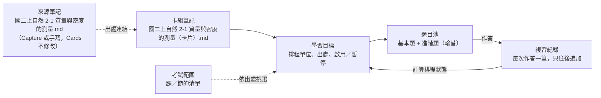
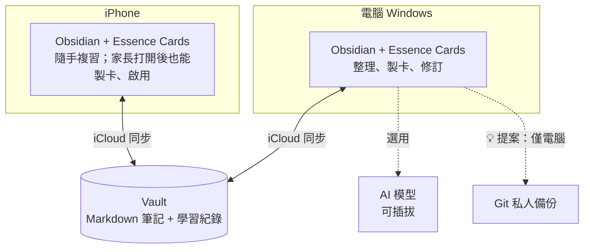

# Essence Cards｜架構

更新：2026-11-20｜狀態：架構釐清七步已完成；出題語法已定稿，檔案格式見[出題語法與資料格式](syntax.md)；2026-11-20 從最上層的架構拆出（D-208 第 8 點，第二步 B），三個外掛的定位與接點（§3）、repo 結構（§9）留在[最上層](../../../docs/architecture.md)

這份文件回答「Essence Cards 技術上怎麼組成」。為什麼做、做到什麼程度見 Cards 的[產品定義](product.md)。

狀態標示：✅ 已確認｜🔁 舊共識，待重新確認｜💬 待討論｜💡 助理提案

## 1. 術語表

| 名詞 | 定義 | 狀態 |
|---|---|---|
| Source（來源） | 課本、PDF、網頁、影片等原始材料 | ✅ |
| Note（筆記） | Obsidian 裡的一篇 Markdown，是人閱讀的單位 | ✅ |
| Knowledge Item（知識項目） | 最小的「有意義知識單位」 | ✅ |
| Learning Target（學習目標） | 最小的「可獨立判斷學生會不會的學習目標」；排程的單位 | ✅ |
| Prompt（題目） | 為了檢核某個學習目標，呈現給學生的一次具體刺激；同一目標可以有多種問法 | ✅ |
| Card（卡片） | 目前主要的題目呈現方式：提示 → 想答案 → 翻面 → 自評 | ✅ |
| Question Type（題型） | 孩子怎麼作答、誰判對錯、結果怎麼記；可以接到不同學習方式的模組，照作答的形式分、每一科與題庫共用，見[題型專區](question-types.md)（[D-181](../../../docs/decisions.md#d-181-題型是可以接上的模組開題型專區)、[D-233](../../../docs/decisions.md#d-233-題型照形式分各科與題庫共用配對單選也進每天複習)） | ✅ |
| Review Event（複習紀錄） | 一次作答的結果；格式見 [§5](#複習紀錄d-035) | ✅ |
| Scheduler（排程器） | 依複習紀錄決定下次出現時間；可以替換；v1 用 FSRS（D-043） | ✅ |
| Review Debt（複習債務） | 每個學習目標帶給未來的複習成本 | ✅ |
| Learning Map（學習地圖） | 一節教材的學習目標分層規劃：每個目標在第幾層、站在哪些目標上、來自課本還是課外。第一次製卡時由 AI 畫好，不排程；加深時才把下一層做成卡，AI 也依學生的狀況修地圖與邊界，以卡組為準（[D-136](../../../docs/decisions.md#d-136-學習地圖課本是起點加深可以超出課本)）。v1 留在 AI 輸出快照裡、家長不直接改，存成程式讀得懂的資料在第二階段 | ✅ |
| Concept（概念） | 跨年級共用的知識節點 | 💡 願景，未採用 |

以上 ✅ 項目除 Review Event、Learning Map 外，都在 2026-10-09 討論中確認（[D-010](../../../docs/decisions.md#d-010-三層概念模型)）；Review Event 在第 6 步確認（[D-035](../../../docs/decisions.md#d-035-複習紀錄格式)），Learning Map 在 2026-10-25 確認（[D-136](../../../docs/decisions.md#d-136-學習地圖課本是起點加深可以超出課本)）。

> 參考：Knowledge Item → Learning Target → Prompt 的關係，和 Anki 的 Note → Card 模型很接近（一則筆記產生多張各自排程的卡）。這代表方向已被驗證可行，可以直接借鏡。

## 2. 概念模型 ✅（第 4 步）

2026-10-10 確認（[D-025](../../../docs/decisions.md#d-025-v1-資料實體)）。v1 只有五種資料：



| 資料 | 說明 |
|---|---|
| 卡組筆記 | 跟來源筆記一對一：一節或一課一篇；家長可以在 Obsidian 直接修改 |
| 學習目標 | 排程的單位；記錄出處（單元與頁碼）與狀態（啟用／暫停） |
| 題目 | 每個學習目標有一個題目池：基本題給前幾次複習，答對後輪流換用進階題（[D-028](../../../docs/decisions.md#d-028-題目池)） |
| 複習紀錄 | 每次作答一筆：哪個目標、哪一題、自評（沒印象／差一點／記住了／太簡單）、時間、裝置（格式見 [§5](#複習紀錄d-035)） |
| 考試範圍 | 一份「課／節」的清單，例如一次段考的範圍；本身不存放卡片（[D-026](../../../docs/decisions.md#d-026-儲存範圍排程分開)；2026-10-15 由「複習範圍」改名，[D-088](../../../docs/decisions.md#d-088-錯題本考試範圍與系統資料夾)） |

排程狀態不是獨立的資料，而是從複習紀錄計算出來的結果，可以隨時重算。另外還有記錄考試錯題的錯題本（[D-061](../../../docs/decisions.md#d-061-錯題補強的流程)、D-088）與 AI 輸出快照（[D-042](../../../docs/decisions.md#d-042-ai-製卡快照)）；這些檔案的格式都在[出題語法與資料格式](syntax.md)。

已確認 ✅：

- 同一學習目標的不同問法共用學習狀態與排程；不同學習目標各自排程。
- 一個學習目標可以綜合多個知識點，例如比較題。
- 方向不同的能力是不同的目標，例如英→中、中→英。中→英包含拼字，學生要打字（[D-066](../../../docs/decisions.md#d-066-作答方式)）。
- 英文的學習維度與能力層次見 [D-123](../../../docs/decisions.md#d-123-英文學習框架與先懂意思再練拼寫)；目前是製卡的設計原則，不增加資料實體或排程層。各層的內容判準隨製卡規則整理討論；發音檢查列第二階段（D-130）（[D-124](../../../docs/decisions.md#d-124-發音檢查列為-v2-之後的加強功能)）。
- 簡單情境是一個學習目標一題（例如單字卡）。學習目標那一行一律寫出來；家長在最上層直接寫題目時，程式自動補上（[D-079](../../../docs/decisions.md#d-079-卡組筆記的結構與學習目標的資料)）。
- **v1 不做獨立的 Knowledge Item**：學習目標記錄出處，就已經隱含知識項目；等做螺旋式學習、跨年級連結時再加，舊資料不受影響。
- **學習目標預先建立**：AI 產生 → 家長審核 → 存檔。依學生狀態動態產生需要 Learner Model，屬於願景。
- **跨課的知識**（[D-027](../../../docs/decisions.md#d-027-跨課題目與重複出現的知識)）：
  - 同一個知識在後面的課再出現時，不新增目標，而是把新例句加進原目標的題目池，並在出處加上新的課。英文單字由程式直接比對，不需要 AI。
  - 真正需要跨課比較的題目，放進比較晚出現的那一課的卡組，出處列出所有相關的課。不建立整合卡組。
  - 錯題補強產生的卡也照同樣規則放。

## 3. 模組邊界 ✅（第 5 步）

見最上層的[〈3. 模組邊界 ✅（第 5 步）〉](../../../docs/architecture.md#3-模組邊界-第-5-步)（D-208 第二步）。

## 4. 平台與裝置 ✅



- 平台是 Obsidian 外掛（[D-004](../../../docs/decisions.md#d-004-第一版平台)）。同步沿用使用者既有的 iCloud，不疊加其他同步服務。
- 家長的 iPhone 在設定頁打開後也能 AI 製卡與啟用草稿，預設關（[D-226](../../../docs/decisions.md#d-226-家長的手機也能製卡與啟用預設關第一批手機只建新檔)）。第一批手機只建新檔：草稿、快照，以及 `紀錄/啟用/` 裡的啟用紀錄；改已有卡組的寫入照舊只在電腦，等第二批用 Cloudflare 當鑰匙。備份與還原只在電腦。
- 獨立 App 已列入未來開發計畫（[D-129](../../../docs/decisions.md#d-129-獨立-app-列入未來開發計畫)）；同步與成本邊界沿用 [D-128](../../../docs/decisions.md#d-128-通用軟體使用者自備同步空間)，具體平台與接法待設計。
- 2026-10-07 可丟棄原型已通過 Windows 與 iPhone 的最小實機驗證：自訂介面、筆記讀寫、iCloud 往返。原型程式已從 main 刪除，保留在 git 歷史（見 [archive](../../../docs/archive/README.md)）。
- 限制：
  - 手機外掛不能使用 Node.js／Electron；電腦才需要的（背景製卡、vault 外備份）只放在一個電腦專用、判斷是電腦才載入的資料夾（[D-148](../../../docs/decisions.md#d-148-電腦專用的主機接點)）。
  - Vault 不是資料庫，跨裝置同時寫入沒有保證。
  - Obsidian 官方指出 Windows 上的 iCloud 可能造成檔案重複或損壞。
  - 雲端只留佔位檔、檔案讀不到時：說明書教保持下載，外掛跳過那一篇、自己重試，存檔受阻時當下說清楚，不自動處理（[D-154](../../../docs/decisions.md#d-154-雲端佔位檔讀不到時預防當下說清楚先實測)）。
- 介面技術：複習相關的畫面用 React 加 Motion；卡組筆記的樣式、設定頁用 Obsidian 內建的方式（[D-051](../../../docs/decisions.md#d-051-複習畫面用-react)）。複習畫面是蓋住 Obsidian 上下欄的全螢幕畫面，攔截觸控事件以免滑開 Obsidian 的側欄（[D-109](../../../docs/decisions.md#d-109-複習畫面原型的實測結論)）。樣式用純 CSS，建立 Essence 自己的設計規範（[D-052](../../../docs/decisions.md#d-052-樣式用純-css)）。
- 程式結構（[D-110](../../../docs/decisions.md#d-110-v1-外掛的程式結構)）：核心分成卡組、學習狀態、範圍與目錄、AI 四個模組，不碰 Obsidian、在 Node 直接測；畫面只跟這四個模組要資料；和 vault 只透過「檔案存取」一個接點（Obsidian 版給外掛、Node 版給測試與工具）；寫回筆記的操作都是「舊文字 → 新文字」的函式，外掛用 `vault.process` 套用。
- 畫面：複習、入口（電腦版有事時多一區「提醒」，狀態列提示，[D-103](../../../docs/decisions.md#d-103-總覽改成入口的給家長一區)）、目錄與卡片管理（含範圍選擇、練習、勾選後批次修改）。核心的索引能跨卡組查詢，寫回卡組筆記的操作集中在核心（[D-057](../../../docs/decisions.md#d-057-目錄畫面與卡片管理)、[D-073](../../../docs/decisions.md#d-073-目錄擴充成卡片管理)）。內容在筆記改，性質在管理畫面改。

### 未來獨立 App（規劃中）

已確認的方向見 [D-129](../../../docs/decisions.md#d-129-獨立-app-列入未來開發計畫)，尚未實作。Obsidian 版作主要開發與驗證入口，獨立版沿用相同核心、製卡規則與格式，各自的宿主入口負責平台差異。畫面元件在可行時共用，Obsidian 的 API、編輯器與其他外掛則需獨立版的替代接點。

- **功能更新**：同一份核心原始碼分別建置與發布為外掛和 App；讀到新版筆記不代表程式已更新，版本相容需另設計。
- **資料讀寫**：依 [syntax.md](syntax.md) 讀寫卡組、附件與複習紀錄，保留目標 ID 與紀錄；內部索引或快取可重建，原始資料作為共同依據。普通教材筆記沿用製卡流程，不能直接當成已完成的卡組。
- **平台接點**：檔案存取與同步、內容渲染與出處跳轉、編輯、AI 入口及裝置設定需準備獨立實作；使用者自備同步空間，原則照 D-128。

開工前的準備、最小相容驗證、驗收與未決選擇集中在[獨立 App 計畫](plans/standalone-app.md)，統一入口見 [backlog 的第二階段清單](backlog.md#第二階段想做的事)。

## 5. 資料存放 ✅（第 6 步）

2026-10-10 確認（[D-025](../../../docs/decisions.md#d-025-v1-資料實體)、[D-026](../../../docs/decisions.md#d-026-儲存範圍排程分開)、[D-033](../../../docs/decisions.md#d-033-教材目錄)～[D-035](../../../docs/decisions.md#d-035-複習紀錄格式)、[D-038](../../../docs/decisions.md#d-038-知識領域不限學業)、[D-040](../../../docs/decisions.md#d-040-卡組的位置)）。各種檔案的寫法見[出題語法與資料格式](syntax.md)（[D-092](../../../docs/decisions.md#d-092-出題語法定稿正式規範)）。

### 分開存放

- **來源筆記、卡組筆記、複習紀錄三者分開存放**：
  - 卡題不寫進來源筆記，因為 Capture 會重新整理來源筆記，閱讀時也不想看到 ID。
  - 複習紀錄不寫進任何筆記，因為一天上百次寫入會造成 iCloud 衝突，也會淹沒版本紀錄。
- 每台裝置要相同的設定（每日時間上限、目標保持率、目前學期、考試倒數）放 `Essence Cards/設定.json`，跟著 iCloud 同步（[syntax §10](syntax.md#10-設定)）；不放外掛資料夾的 `data.json`：電腦寫 `.obsidian` 裡的檔會被 iCloud for Windows 改成衝突副本，舊版的 `data.json` 新版只讀（[D-201](../../../docs/decisions.md#d-201-設定改存-vault-裡的一般檔電腦不再寫-datajson)）；只屬於一台裝置的值放 localStorage（裝置碼、備份位置、預覽開關），API 金鑰也是。
- 學習紀錄與排程由 Cards 管理；作答保留當時的題目版本（題目指紋），筆記修改後舊紀錄的意義不變。
- **儲存、範圍、排程三者分開**：
  - 儲存：卡組只放在 `Essence Cards/` 裡，怎麼分資料夾由使用者決定，可以隨時搬動、改名（D-040）。年級學期、科目、單元編號記在卡組筆記裡，不從資料夾推導。
  - 考試範圍：「課／節」的清單，也可以加上分類（D-064）。學習目標屬於的單元（卡組本身的單元，加上出處寫到的）只要有任何一個在範圍內就納入；選分類時，有該分類的卡組都納入（v1 不生效，第二階段才做，[D-142](../../../docs/decisions.md#d-142-範圍與目錄模組的六項選擇)）。考試期間選填，一次只有一份生效（D-098）。
  - 排程：掛在每個學習目標上。
- 學生和家長不需要在檔案樹裡找東西：學生只看到「今天要複習」，家長透過外掛的管理畫面篩選。
- 來源筆記不必放進這個資料夾，卡組用連結指向它們。PDF 不放進 vault：Capture 只在轉錄時讀取，之後只用轉錄稿（[D-076](../../../docs/decisions.md#d-076-capture-是知識入口教材轉錄成教材庫)）。

```
Essence Cards/
├─ 學業/                         ← 預設：學業/年級學期/科目/
│  └─ 國二上/
│     ├─ 自然/
│     │  ├─ 國二上自然 1-1 長度與體積的測量（卡片）.md
│     │  └─ 國二上自然 2-1 質量與密度的測量（卡片）.md
│     └─ 英文/
│        └─ 國二上英文 L1 Back to School（卡片）.md
├─ 構圖基礎（卡片）.md            ← 其他領域：預設直接放這裡，也可以自己分資料夾
├─ 睡眠與記憶（卡片）.md
├─ 教材庫/                       ← Capture 寫入；有裝 Cards 時的預設位置，可以自訂（D-088 補充）
│  └─ 國二上/自然/
│     ├─ 國二上自然 2-1 質量與密度的測量.md
│     └─ 圖/國二上自然 2-1 圖2-3.png
├─ 考試範圍/
│  ├─ 2026-10-28 國二上.md        ← 一次只有一份生效，過期的留著當紀錄（D-098）
│  └─ 小考/2026-11-05 小考.md     ← 一個小考一份，只決定入口多一列，不改排程（D-189）
├─ 錯題本/
│  └─ 國二上自然 第一次段考.md   ← 一次考試一科一份（D-088）
├─ 記憶錨點/
│  └─ 2026-10-19 補記憶錨點.md   ← 一次補錨點一份草稿（D-108）
├─ 製卡規則/                     ← ④ 家長調整與自訂版；內建的 ①～③ 在外掛裡（D-151）
├─ 設定.json                     ← 每台裝置相同的設定，只有 Essence Cards 寫（D-201）
└─ 紀錄/                         ← 複習紀錄，每台裝置每月一個檔
   ├─ 2026-10 iPhone-7f3a.jsonl
   ├─ 2026-10 Windows-2c9e.jsonl
   ├─ 考試切面/                  ← 考試開始時範圍內的卡組原文，一次考試一台一份（D-115）
   ├─ AI 輸出/                   ← AI 輸出快照，一次一個檔（D-042）
   │  └─ 2026-10-12 國二上自然 2-1 質量與密度的測量（卡片）.md
   └─ 錯誤/                      ← 外掛自己的錯誤紀錄，每台裝置每月一個檔，給維修用（D-155）
      └─ 2026-11 iPhone-7f3a 錯誤.jsonl
```

考試範圍、錯題本、記憶錨點、製卡規則、紀錄五個系統資料夾的位置固定（[D-088](../../../docs/decisions.md#d-088-錯題本考試範圍與系統資料夾)、[D-108](../../../docs/decisions.md#d-108-補記憶錨點的草稿集中成一份)）；其他位置都可以放卡組。外掛把 `Essence Cards/` 裡、系統資料夾以外的 Markdown 筆記都當成卡組，沒有學習目標的筆記就沒有東西可複習，不會出錯（[D-041](../../../docs/decisions.md#d-041-卡組的辨認與分類)）。教材庫不是系統資料夾：轉錄稿有「來源類型」屬性，外掛看到就不當成卡組，放在哪裡都一樣（D-088 補充）。檔名整個 vault 不重複（[D-081](../../../docs/decisions.md#d-081-卡組屬性與檔名)）。

### 分類：都用屬性（D-041、D-064）

| 資訊 | 放在哪裡 | 例子 |
|---|---|---|
| 年級學期、科目、單元編號、狀態 | 卡組的 YAML 屬性 | `科目: 自然`、`狀態: 草稿` |
| 領域、主題等自由分類 | 卡組的 YAML 屬性；不用 Obsidian 標籤（D-064） | `分類: [醫學, 睡眠]` |
| 出處 | 每個學習目標 | `p.45、圖 2-3`；跨單元 `國二上 1-3 p.20`；其他筆記寫連結（[syntax §2-5](syntax.md#2-5-出處)） |
| 複習進度 | 不在 YAML，只在[複習紀錄](#複習紀錄d-035) | — |

屬性的名稱與寫法見[出題語法與資料格式 §2-1](syntax.md#2-1-屬性)（[D-081](../../../docs/decisions.md#d-081-卡組屬性與檔名)）。考試範圍可以選單元，也可以選分類，例如「自然 1-1～2-2」和「醫學」；選分類延到第二階段（[D-142](../../../docs/decisions.md#d-142-範圍與目錄模組的六項選擇)）。家長加分類時，外掛列出已經用過的分類讓家長點選。

Essence Cards 的卡組與卡片都不用 Obsidian 標籤；Essence Capture 產出的筆記可以用（D-064）。

### 教材目錄（D-033）

教材目錄邊用邊長，不另存檔案。只有學業卡組有單元編號，所以目錄與考試範圍只用在學業卡組；其他領域的卡到期就複習，一樣受每日上限控制（D-038）。

- 每篇卡組記下年級學期、科目、單元編號與名稱。年級學期與科目相同的卡組，依單元編號自動排序，就是那一冊的目錄；跟卡組放在哪個資料夾無關（D-040）。建立 2-2 的卡組後，目錄就多出 2-2。
- 層級由編號表示：「2-」開頭的都屬於第 2 章；英文的 L1 只有一層；高中、大學更多層時照課本編號，例如 1-2-3。
- 範圍可以選整章或單一節，一行一個編號（[D-176](../../../docs/decisions.md#d-176-考試範圍第二批的選擇手改的範圍檔不默默失效提前結束立刻失效)）；「比較晚出現的那一課」也依編號判斷。
- 出處記錄頁碼與圖表，例如「p.45、圖 2-3」，沒寫單元就是卡組本身的單元；科目與年級學期由卡組筆記決定（[D-080](../../../docs/decisions.md#d-080-轉錄稿的錨點與出處的寫法)）。

### 學習目標 ID（D-034）

- 程式產生的隨機短碼，例如 `k3m9x2`；不和現有的 ID 重複，刪除後不再使用。
- 家長與 AI 都不寫，由程式補上（[D-079](../../../docs/decisions.md#d-079-卡組筆記的結構與學習目標的資料)）；什麼時候補、怎麼不被編輯弄壞見 [D-134](../../../docs/decisions.md#d-134-學習目標-id-的補上時機與保護)。
- 改題目文字、搬到別的卡組、改檔名，ID 都不會變。
- 題目不編號，用內容指紋識別（[D-046](../../../docs/decisions.md#d-046-題目以內容指紋識別)）。
- 寫成 Obsidian 原生的區塊 ID，放在學習目標那一行最後（[出題語法 §2-3](syntax.md#2-3-學習目標)）。

### 直接編輯卡組（D-036）

家長可以不經外掛介面，直接在 Obsidian 修改卡組筆記（[D-036](../../../docs/decisions.md#d-036-直接在-obsidian-編輯卡組)）。外掛因此要處理介面之外的修改：

- AI 產生的卡組先標成草稿，學生看不到；家長改好後改成啟用（[D-039](../../../docs/decisions.md#d-039-v1-範圍)）。
- 審核以「刪除方便」為優先：家長大多沒空修改 AI 產生的卡，但修改的權限一律保留（[D-042](../../../docs/decisions.md#d-042-ai-製卡快照)）。
- 學習目標 ID 的補上、保護與重複時的處理，見 [syntax §2-3](syntax.md#2-3-學習目標)。
- 語法有錯時，不讓整篇卡組失效：只跳過有問題的那個學習目標，並在編輯畫面與目錄提示家長（[D-089](../../../docs/decisions.md#d-089-語法的邊界規則與寫錯時的處理)）。

### 複習紀錄（D-035）

每台裝置每個月一個 `.jsonl` 檔，每作答一次追加一行，不修改已寫入的紀錄；從備份還原時補回的行，由還原的那台電腦另寫成還原檔（[出題語法 §5-3](syntax.md#5-3-還原檔)、[D-150](../../../docs/decisions.md#d-150-備份與還原)）。欄位（作答時間、學習目標 ID、自評、題目指紋，以及選填的來源與取消）見[出題語法與資料格式 §5](syntax.md#5-複習紀錄)。

- 裝置寫在檔名上。💡 實作提案：裝置碼在第一次開啟時隨機產生，只存在那台裝置上；同一台裝置、同一個時間只會有一筆，iCloud 產生衝突副本時可以安全合併。
- 每按一次自評就立刻追加一行，在背景寫入；App 被關掉最多只少了當下還沒按的那一張（[D-074](../../../docs/decisions.md#d-074-中斷與恢復)）。
- 不記作答秒數（[D-011](../../../docs/decisions.md#d-011-不計作答時間)）；每天複習幾分鐘，從相鄰作答的時間間隔推算，供[成功標準](product.md#2-成功標準-第-1-步)與之後的儀表板使用。
- 排程狀態由各裝置從全部紀錄計算，快取只存在本機、不同步，隨時可以重算；v1 先不做快取，量過三年份紀錄的讀取加重播再決定（[D-110](../../../docs/decisions.md#d-110-v1-外掛的程式結構)）。排程演算法用 FSRS（[D-043](../../../docs/decisions.md#d-043-排程採用-fsrs)），目標保持率預設 80%，考試範圍填了考試期間後，範圍內的卡考前到結束日都用 90%（[D-078](../../../docs/decisions.md#d-078-目標保持率與考前提高)、[D-098](../../../docs/decisions.md#d-098-考試範圍只用在大考日期改成考試期間)）；重播計算的做法見[舊外掛分析 §7-10](research/old-flashcard-plugin.md#7-10-排程)。

為什麼按月分檔，而不是一直追加在同一個檔案（2026-10-10 使用者提問）：

- **同步量**：據第三方觀察，iCloud 對一般檔案是整個檔案重新上傳，不像 Dropbox 只傳改過的部分（Apple 沒有公開說明）。每天 15 分鐘約 100～150 次作答，一年約 5 MB；從國中用到大學考試，單一檔案會累積到數十 MB，每次複習後都要整個重傳。按月分檔，每次只傳當月幾百 KB。
- **損壞範圍**：Windows 上的 iCloud 可能造成檔案損壞（§4）；分檔時最多影響一個月的紀錄。
- **開啟速度**：過去月份的檔案不再變動，之後要加本機快取時可以只重讀當月，符合「打開就能複習」（原則 2）；v1 先不做快取（D-110）。
- 代價很小：學生與家長看不到這些檔案，程式只要多讀幾個檔。

### 出題語法 ✅

2026-10-16 定稿（[D-092](../../../docs/decisions.md#d-092-出題語法定稿正式規範)）。卡組筆記、轉錄稿、錯題本、考試範圍、複習紀錄、AI 輸出快照的寫法，集中在[出題語法與資料格式](syntax.md)；家長手寫與 AI 產生的卡組用同一套語法（[D-030](../../../docs/decisions.md#d-030-出題語法規範)）。摘要：

- 沿用舊外掛的 `問題 :: 答案`、`問題 ::` 加子項目、`==填空==`，只在卡組筆記生效；不提供反向、雙向與段落內嵌的語法，每個方向各寫一行（[D-050](../../../docs/decisions.md#d-050-不提供反向與雙向語法)）。
- 清單最上層的每一項是一個學習目標，ID 寫在那一行最後；底下是題目、資料（出處、類型、重要性、狀態、備註、錯題補強，用「｜」分隔）與共用的背面補充（[D-045](../../../docs/decisions.md#d-045-學習目標用清單縮排表示)、[D-079](../../../docs/decisions.md#d-079-卡組筆記的結構與學習目標的資料)）。
- 一行多個填空一次全挖，一行＝一題（[D-049](../../../docs/decisions.md#d-049-一行多個填空一次全挖)）；題目用內容指紋識別（[D-046](../../../docs/decisions.md#d-046-題目以內容指紋識別)）；編輯畫面用樣式標出學習目標與題目（[D-047](../../../docs/decisions.md#d-047-編輯畫面標示卡組結構)）。
- 英文的方向寫在名稱裡，例如「borrow 英翻中」；中翻英要打字，兩個方向配成一組（[D-082](../../../docs/decisions.md#d-082-英文卡組與朗讀)）。
- 出處寫短的，例如 `p.44、圖 2-14`，程式透過卡組的「材料」連到轉錄稿的錨點（[D-080](../../../docs/decisions.md#d-080-轉錄稿的錨點與出處的寫法)）。
- 寫錯時只跳過有問題的那個學習目標（[D-089](../../../docs/decisions.md#d-089-語法的邊界規則與寫錯時的處理)）。
- AI 交回的文字就是卡組的本文：給家長的備註在最上面、直接附圖、候選卡片摺在最後（[D-091](../../../docs/decisions.md#d-091-ai-製卡的輸出格式)）。

### 設計提案 💡（來自舊技術路線圖，待驗證）

- Git 只在電腦執行，負責歷史與救回；iCloud 負責同步。完整 Git 設計見 [v0 技術路線圖](../../../docs/archive/v0-planning/technical-roadmap.md#git-備份與版本回復的設計重點)。

## 6. AI 的位置 ✅（細節之後專門討論）

- 沒有 AI 時，Essence Cards 是完整的間隔重複複習軟體。
- 接上 AI 後，它成為「知識 → 複習」的轉換系統，例如產生題目、評估答案、解釋錯誤。
- 模型可以插拔，不指定供應商；AI 的建議與人的確認分開記錄（[D-007](../../../docs/decisions.md#d-007-ai-選用且可插拔)）。
- AI 最有價值的位置在「來源 → 知識項目 → 學習目標 → 題目」這段；「複習 → 檢核 → 排程」這段不需要 AI。
- AI 在程式裡就是一次呼叫：送出「教材 ＋ 學生年級 ＋ 製卡規則」，收回用出題語法寫成的學習目標與題目，存成草稿，由家長修改後啟用。AI 負責三件事：從教材製卡、分析錯題、產生英文記憶錨點。
- **直接呼叫只走 API 金鑰，尚未實作**（[D-231](../../../docs/decisions.md#d-231-外掛直接呼叫-ai-只走-api-金鑰取消訂閱接法)）：家長在設定頁選服務、貼上自己的金鑰，Cards 送出、收回、檢查並存草稿；用訂閱登入、背景啟動 Claude Code 或 Codex CLI 的接法已取消（原本 [D-126](../../../docs/decisions.md#d-126-訂閱優先的-ai-製卡與側欄修改) 第 1 點）。
  - 交給其他 AI／匯入結果：保留複製貼上與手動匯入的共通備援；匯入共用檢查、ID、快照與草稿流程。
  - API 直連照 D-059、D-072、D-085、[D-232](../../../docs/decisions.md#d-232-ai-連線做成共用套件講四種方言能拿到別的-repo)：連線用最上層的共用套件 `packages/ai-client/`，Cards 經自己的轉接檔、用相對路徑 import 套件的入口檔；連線用 `fetch`，回覆一段一段收、可以取消，某一家擋 CORS 時只有那一家改走 `requestUrl`（[D-241](../../../docs/decisions.md#d-241-外掛直接呼叫-ai-用-fetch-連線)）；做法見 [AI 連線模組的任務說明](../../../docs/tasks/ai-client.md)。Capture、Mindboard 開工時再評估接法。
- **固定生成與自由修改分開**：製作、加深、錯題分析由 Cards 按鈕送出一次請求；個別修改在 Obsidian 筆記，可用 Claudian 側欄。Cards 不另做聊天或修改畫面，也不寫 Claudian 專用接點；只提供從 syntax.md 產生的寫法 skill、結構檢查及既有卡組指令。偵測到 Claudian 時提供設定開關，是否讀取 skill 與差異接受流程仍待驗證。家長已核對該次差異並接受，不再重複審核；側欄權限由家長設定，背景生成的「不開工具」不套用到自由對話（D-126）。
- **ID 與進度**：筆記變動時檢查有紀錄的 ID 消失、同篇 ID 重複；只檢查結構，不判斷能力是否改變。已複習目標拆分／合併後，舊紀錄保留，新目標配新 ID 並從頭開始，只提示不要求家長選承接關係（D-126，規劃中）。
- ✅ API 金鑰只存在電腦本機、vault／repo 以外：不經 iCloud 同步到手機或進 Git；不宣稱能與其他外掛隔離（[D-003](../../../docs/decisions.md#d-003-公開範圍)、D-126、D-231）。
- ✅ 模型的選擇原則（[D-055](../../../docs/decisions.md#d-055-ai-模型的選擇原則)）：免費或開源優先，其次是 CP 值高、成本低的模型；不限定任何一家；可以接受免費方案把資料拿去訓練。
- API 直連的做法（[D-059](../../../docs/decisions.md#d-059-ai-的接法一種介面模型不包進外掛)、[D-232](../../../docs/decisions.md#d-232-ai-連線做成共用套件講四種方言能拿到別的-repo)）：
  - ✅ **API 選項經共用套件講四種方言**：OpenAI Responses、OpenAI 相容的 Chat Completions、Gemini、Anthropic；OpenRouter（含免費的開源模型）、DeepSeek、Groq、Mistral，以及電腦本機跑的 Ollama、LM Studio 都講 OpenAI 相容的那一種。家長從預設選單選一個、貼上金鑰，網址與模型由外掛填好，也可以自訂（[D-072](../../../docs/decisions.md#d-072-ai-服務的推薦與設定方式)）；API 推薦的服務與模型見 [AI 模型推薦](../../../docs/ai-models.md)。講這四種之一的廠商只加目錄資料，不改 Cards 的程式。
  - ✅ **教材怎麼送給 AI**（[D-076](../../../docs/decisions.md#d-076-capture-是知識入口教材轉錄成教材庫)）：PDF 與圖片由 Capture 轉成頁面圖片送去轉錄，圖表截成圖片放進轉錄稿；Cards 製卡時送出轉錄稿與裡面的圖片。所以兩個外掛都需要能看圖的模型。Obsidian 內建的 PDF 元件能不能讓外掛轉圖片，寫程式前確認。2026-11-16 起 Capture 移到第二階段，v1 的教材由家長在自己的 AI 對話附課本（[D-206](../../../docs/decisions.md#d-206-essence-capture-移到第二階段v1-的教材直接附給-ai)）；接上 API 時教材怎麼送，到那時候再定。
  - **用量估計**：一次製卡約 1.5～2 萬 token 輸入、3 千 token 輸出；一學期約 60 次，約 100 萬 token 輸入。便宜的模型一學期不到 1 美元，免費額度也夠用（OpenRouter 免費模型每天約 50 次）。價格與額度常變，寫程式前查官方頁面。
  - ✅ **真正的成本是審核時間**：模型差一點，家長要多刪改，學生要多複習不好的卡。預設模型依卡片品質挑，比較 2～3 個候選模型（由 API 規劃在 `experiments/` 實測；NotebookLM 對照實驗暫緩）。開源模型要特別檢查是否用台灣用語。
  - **複製貼上模式仍是最省錢的路**：各家網頁版的免費方案，常常比免費 API 用得到更強的模型。
- ✅ 本機開源模型列為保留擴充，不在 v1（[D-055](../../../docs/decisions.md#d-055-ai-模型的選擇原則) 補充）：一般使用者沒有獨立顯卡。Ollama 講 OpenAI 相容的介面，共用套件本來就能接，之後要用不必另外寫程式。
- ✅ 模型檔不包進外掛，也不放進 vault（[D-059](../../../docs/decisions.md#d-059-ai-的接法一種介面模型不包進外掛)）：
  - 外掛資料夾 `.obsidian/plugins/` 在 vault 裡，會經 iCloud 同步到每台裝置，包括 iPhone。語音模型約 90～330 MB，語言模型要數 GB。
  - Obsidian 每次啟動都要載入外掛，檔案太大會拖慢啟動（D-051 在意啟動時間）；iCloud 也可能把大檔案從 iPhone 移除，外掛就載入失敗。
  - iPhone 本來就不需要模型：製卡在電腦上做（D-019）；家長在手機上 AI 製卡也是複製貼上，交給 AI App（D-226），手機只要結果。英文朗讀用裝置內建的系統語音，預先產生的音檔已暫停（[D-082](../../../docs/decisions.md#d-082-英文卡組與朗讀)）。
  - 做法：模型放在電腦本機，可以是另外安裝的程式（例如 Ollama），也可以第一次使用時下載到 vault 以外的快取。外掛本身維持很小，只把結果存進 vault，例如音檔。
- ✅ AI 製卡快照（[D-042](../../../docs/decisions.md#d-042-ai-製卡快照)）：
  - Cards 呼叫 AI 產生草稿（製卡、加深、錯題分析、補記憶錨點）時，把原始輸出存到 `紀錄/AI 輸出/`，一次一個 Markdown 檔；記下日期、卡組或錯題本、規則版本、材料（只記連結）、接法與模型（格式見[出題語法 §6](syntax.md#6-ai-輸出快照)；錯題分析也存，D-093）。輸入版本與規則證據照 D-115；可追溯 Cards 提交什麼，不宣稱模型實際理解了全部內容。
  - 存草稿時就配好 ID（候選卡片也配），快照用同一組 ID。快照有、卡組沒有＝生成後刪掉；內容不同＝改過；卡組有、快照沒有＝後來新增。側欄自由修改不另存快照、不標作者，沒有與第一次生成同等的 D-115 證據；差異不能直接當作原稿錯誤，原因不明就保留不明（D-126）。
  - 用途：改進製卡規則（§7）、累積評測集，並讓 AI 的建議與人的確認分開記錄（D-007）。v1 用快照算採用率，用錯題本的「卡片沒涵蓋」算漏掉率，不另做評測工具（D-042 補充）。
  - 複製貼上模式要把結果貼進外掛的輸入框才會存快照；直接貼進卡組筆記照樣能用，只是沒有快照。
  - v1 只存檔，不做比對畫面；要不要分析由家長決定。其他功能都不讀快照，將來要拿掉只要停止寫入、刪掉資料夾。
  - 檔案量：只有呼叫 AI 產生草稿時才產生，一次一個約 5～10 KB 的檔；一學期約幾十個，用到大學考試約幾百個、幾 MB，比一本課本 PDF 還小。外掛辨認卡組時直接跳過系統資料夾（D-041），複習時不讀快照。不合併成月檔，一次製卡一個檔（2026-10-10 使用者確認）。
  - 💡 建議把 `Essence Cards/紀錄/` 加進 Obsidian 的「排除的檔案」（設定 → 檔案與連結），搜尋與關係圖就不會出現快照。
- 輸入資料原則 ✅：教材是「學什麼、學到多深」的依據，AI 的通用知識只用來補充解釋與例子，並標 [AI 補充]。2026-10-25 起，教材是第一次製卡的邊界，不是上限：熟了之後，加深可以出超出課本的課外層，附可查的來源、算延伸（[D-136](../../../docs/decisions.md#d-136-學習地圖課本是起點加深可以超出課本)）。英文需要單字表與這一課的文法重點（[D-193](../../../docs/decisions.md#d-193-英文的學習地圖詞是根句型是骨架)）；自然需要課本頁面。2026-10-10 [製卡規則試用](card-rules/trials.md)的對照實驗已確認：有附課本明顯比較好（[D-021](../../../docs/decisions.md#d-021-教材是製卡依據)）。

## 7. 製卡規則 ✅

產品品質主要取決於製卡規則，不是模型本身（[D-020](../../../docs/decisions.md#d-020-製卡規則分層)）。規則分四層，每次製卡時，軟體把四層規則連同教材、年級、已熟練的目標與錯題一起送給 AI：

| 層級 | 內容 | 誰維護 |
|---|---|---|
| ① 通用規則 | 學習目標的拆分標準、控制題數（複習債務）、答案須出自教材並標出處、用詞符合年級、輸出格式 | 開發者 |
| ② 知識類型規則 | 詞彙、定義、因果、比較、順序、實驗、公式、圖表各自怎麼出題 | 開發者 |
| ③ 科目預設 | 知識類型的組合，例如英文 ＝ 詞彙 ＋ 文法 ＋ 例句 ＋ 有連結才加的錨點（發音由系統語音朗讀，D-082；D-193）；學業以外的領域用「一般知識」預設（D-038） | 開發者 |
| ④ 家長調整 | 白話設定，例如「每節最多 10 張」、「多出為什麼題」 | 家長 |

- 依**知識類型**區分，不是依科目：同一科混有多種類型，不同科目會共用類型。
- 規則是 Markdown，與模型無關：①～③ 的內建版跟著外掛更新，不寫進 vault；④ 家長調整放 vault 的 `製卡規則/`。家長要改內建的某一份，就複製成自訂版取代它；新版內建改了再提示家長選（[D-151](../../../docs/decisions.md#d-151-內建製卡規則改版內建跟著外掛改了就是自訂版)）。
- 規則的來源：先由開發者起草 → 用真實教材試用校正 → 成為內建預設與評測集 → 使用中依回饋找原因，原因在規則時才改（[D-114](../../../docs/decisions.md#d-114-產品核心以學習目標為單位回饋先找原因)）。
- 限制：計算與應用題不適合閃卡，之後由題庫負責（[D-090](../../../docs/decisions.md#d-090-題庫併入-cards變式題以題型排程)）。
- 目前版本：[docs/card-rules/](card-rules/README.md)（💡 試用中）。輸出格式必須符合[出題語法與資料格式](syntax.md)。
- **重整中**（[D-228](../../../docs/decisions.md#d-228-製卡規則重整成核心任務模組科目模組先用比較測試判斷)）：上面的四層改成照「什麼時候用得到」分的共用核心（每次送）、任務模組（製作、加深、錯題分析）與科目模組，家長調整照舊。英文與國小社會過了[比較測試](tasks/rule-restructure-test.md)的三道門檻才換（重大錯誤那一道改成候選每份的平均不比現行多，[D-234](../../../docs/decisions.md#d-234-比較測試的重大錯誤門檻改成每份平均不比現行多)），其他科各自要有證據；換之前照現行。

## 8. 整條鏈的分工 ✅

使用者要求記錄（[D-114](../../../docs/decisions.md#d-114-產品核心以學習目標為單位回饋先找原因)）。大多是既有決定的整理；還沒定的標「待定」，不代表 v1 的行為。

角色：**開發者**指維護內建規則的人，目前是使用者加上 Claude；**家長**、**學生**是外掛的使用者；**程式**指外掛自己做的事；**AI** 指製卡時呼叫的模型，在外層循環裡則是開發者用的 AI。

| 環節 | 步驟 | 誰做 | 依據 |
|---|---|---|---|
| 教材 | PDF、圖片轉錄成教材庫 | AI（Capture） | [D-076](../../../docs/decisions.md#d-076-capture-是知識入口教材轉錄成教材庫)，移到第二階段（[D-206](../../../docs/decisions.md#d-206-essence-capture-移到第二階段v1-的教材直接附給-ai)） |
| 教材 | 轉錄稿和原頁比對 | AI 比對並標出沒把握的地方；不要求家長查證 | D-076、D-114 |
| 教材 | 推薦的 AI 服務與模型 | 開發者實測後推薦 → 家長從預設選單選 | D-072、D-085 |
| 規則 | ① 通用、② 知識類型、③ 科目預設 | 開發者 | [D-020](../../../docs/decisions.md#d-020-製卡規則分層) |
| 規則 | ④ 家長調整；其他層要改時複製成自訂版 | 家長 | D-020、[D-151](../../../docs/decisions.md#d-151-內建製卡規則改版內建跟著外掛改了就是自訂版) |
| 規則 | 內建規則改版時，怎麼處理家長改過的檔案 | 沒改過的跟著更新；自訂版不自動更新，有新版時提示家長選留著、換回或請 AI 合併 | [D-151](../../../docs/decisions.md#d-151-內建製卡規則改版內建跟著外掛改了就是自訂版) |
| 製卡 | 選教材、發起製卡 | 家長（複製貼上或 API 直連） | D-039 |
| 製卡 | 把規則、年級、已有的目標、錯題組好送給 AI | 程式 | §7 |
| 製卡 | 拆出學習目標、出題、交稿前自我檢查 | AI | D-039、D-101、[通用規則](card-rules/common.md) |
| 製卡 | 語法檢查：寫錯只跳過那個目標並提示 | 程式 | D-089 |
| 製卡 | 配學習目標 ID、存 AI 輸出快照 | 程式 | D-034、D-042、D-115 |
| 製卡 | 審核：刪、改、啟用 | 家長 | D-039 |
| 複習 | 每天的份、出卡順序、排程 | 程式（FSRS） | D-043、D-071 |
| 複習 | 作答、四級自評；英文打字與相似字比較卡由程式比對 | 學生、程式 | D-062、D-066、D-116、D-121、D-178 |
| 複習 | 題目池輪換問法 | 程式 | D-028 |
| 複習 | 題目池補新題 | AI；觸發時機待定 | D-028、[backlog](backlog.md#其他待決) |
| 複習 | 設考試範圍與考試期間 | 家長或學生 | D-097、D-098 |
| 複習 | 目錄替單元或一篇設小考日期 → 入口最上面一列 → 全部卡一輪 | 家長或學生 | D-189 |
| 複習 | 考前抽測：抽題 → 作答 | 程式抽題 → 學生作答，也可以由家長問 | D-075、D-107 |
| 內層循環 | 某一題總是答錯 → 提醒拆開 | 程式提醒 → 家長決定 | D-028 |
| 內層循環 | 錯題：整頁拍 → 錯題本草稿 → 採用 | 家長 → AI → 家長 | D-061、D-113 |
| 內層循環 | 加深：上一次還沒記穩的有一半記穩時在提醒區提示（D-209），或家長自己按 → 按「加深」→ 照學習地圖產生下一層、順手修地圖 → 審核 | 程式提示 → 家長 → AI → 家長 | D-100、[D-136](../../../docs/decisions.md#d-136-學習地圖課本是起點加深可以超出課本)、[D-194](../../../docs/decisions.md#d-194-加深的主動提示記穩了三分之一就問按一下才做) |
| 內層循環 | 記憶錨點：找出常錯單字 → 產生 → 審核 | 程式 → AI → 家長 | D-103、D-108 |
| 內層循環 | 「給家長」的建議，包括考後提醒上傳考卷 | 程式提示 → 家長決定 | D-103 |
| 外層循環 | 收集證據：快照、錯題本、複習紀錄、考前卡組切面 | 程式 | D-042、D-105、D-115 |
| 外層循環 | 比對 ID、計數、照固定條件重跑 | 程式 | D-114 |
| 外層循環 | 讀內容：附依據的候選原因、改規則的提案、語意初篩 | AI | D-114 |
| 外層循環 | 決定採不採用 | 內建規則由開發者決定；家長改的規則由家長決定 | D-075、D-114 |
| 外層循環 | 記錄規則版本與試用結果 | AI | [試用紀錄](card-rules/trials.md) |

## 9. repo 結構 ✅（D-208）

見最上層的[〈9. repo 結構 ✅（D-208）〉](../../../docs/architecture.md#9-repo-結構-d-208)（D-208 第二步）。
