# 自己寫卡組

適合誰看：寫卡組筆記的人｜對應版本：0.6.0｜最後查核：2026-11-22

卡組就是一篇 Obsidian 筆記。用清單寫下「要學會什麼」和「怎麼問」，按一下存檔，卡片就會排進複習。這一節在電腦上做。

## 步驟

### 1. 在 Essence Cards 資料夾裡新增一篇筆記

放在 `Essence Cards/` 裡的任何位置都可以，也可以自己開子資料夾，例如 `Essence Cards/學業/國二上/自然/`。只有五個系統資料夾不能放：考試範圍、錯題本、記憶錨點、製卡規則、紀錄。

檔名在整個 vault 裡不要重複。

### 2. 在最上面寫年級學期、科目、單元

```markdown
---
年級學期: 國二上
科目: 自然
單元: 3-1 聲音的產生與傳播
---
```

目錄照這三項排。單元寫成「編號 名稱」，中間空一格。Obsidian 會把這一段顯示成「屬性」的表格（下一張圖的上半）。

### 3. 一行寫一個學習目標

清單最上層的每一行是一個學習目標，寫成「能……」。

```markdown
- 能說出聲音是怎麼產生的
```

### 4. 在目標底下縮排一層，寫題目

`::` 的左邊是題目，右邊是答案。答案裡最重要的字用粗體。

編輯畫面會幫你標出結構：學習目標那一行的左邊有一條淡紫色的細線，題目的 `::` 也是淡紫色。

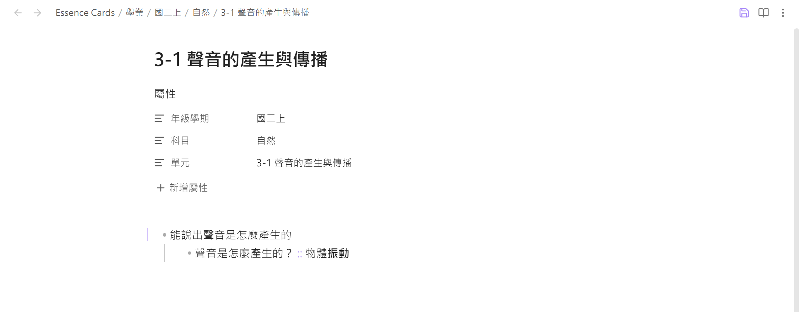

```markdown
- 能說出聲音是怎麼產生的
    - 聲音是怎麼產生的？ :: 物體**振動**
```

### 5. 按筆記右上角的存檔按鈕

存檔按鈕是筆記右上角的磁碟片圖示，上面沒有字。有學習目標還沒加入複習時它是紫色的，滑鼠移上去會寫「筆記已自動儲存；有 1 個學習目標尚未加入複習」。

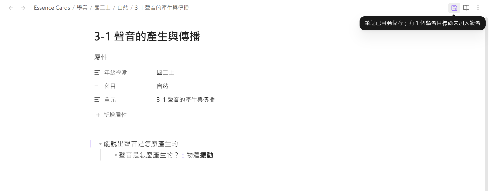

按下去，通知會寫「1 個學習目標已加入複習」，按鈕變成灰色的打勾。名稱那一行的最後會多一個寫著「ID」的小標籤，那是程式補上的編號，不用理它，也不要改它。

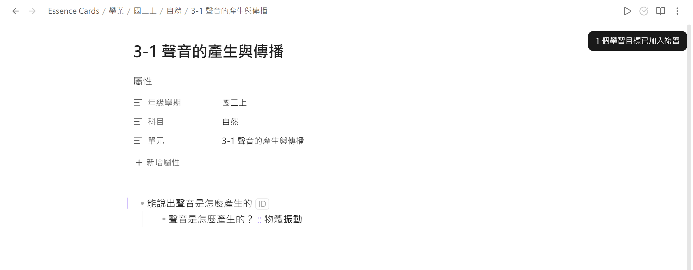

按鈕旁邊多出來的 ▷ 是這一篇的「全部卡」。

忘了按也沒關係，離開這篇筆記時程式會補一次。

### 6. 複習時看到的樣子

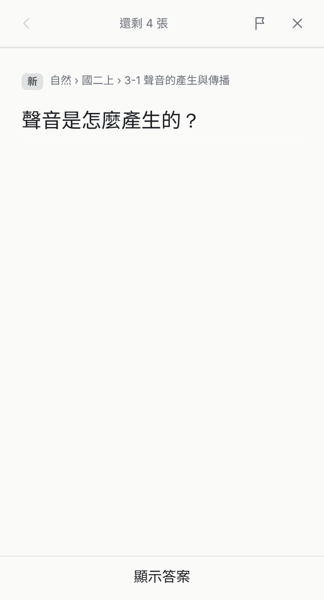
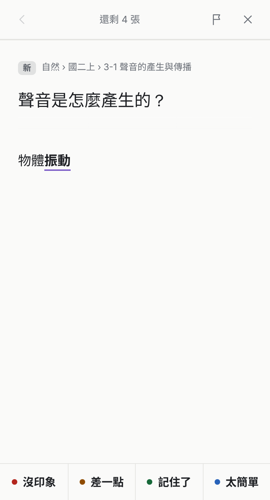

題目在正面，翻面後是答案，粗體的字會畫上底線。學習目標的名稱不會顯示在卡片上。

## 題目的四種寫法

四種寫法寫在同一篇裡，編輯畫面是這樣。下面一種一種說明。

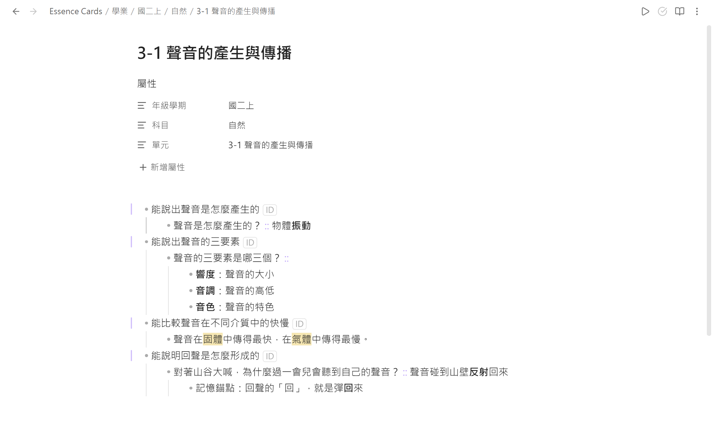

### 問答

```markdown
- 聲音是怎麼產生的？ :: 物體**振動**
```

最常用。答案短而明確，或是能對照一到三個重點的理解題。

### 答案有好幾行

```markdown
- 聲音的三要素是哪三個？ ::
    - **響度**：聲音的大小
    - **音調**：聲音的高低
    - **音色**：聲音的特色
```

`::` 後面先不寫，答案一項一行，寫在底下再縮排一層。

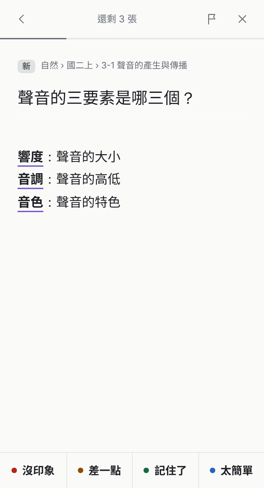

### 填空

```markdown
- 聲音在==固體==中傳得最快，在==氣體==中傳得最慢。
```

把要挖掉的字用 `==` 包起來。一行裡的空格會一起挖掉，翻面一次看全部。

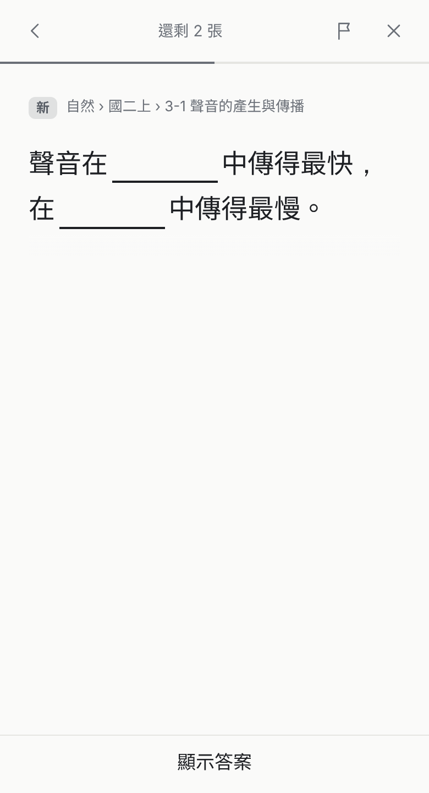
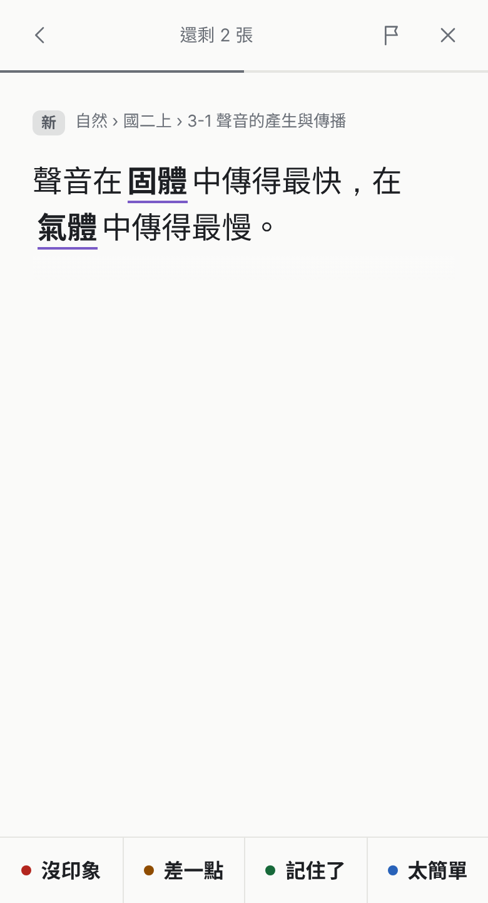

### 在背面加補充

```markdown
- 對著山谷大喊，為什麼過一會兒會聽到自己的聲音？ :: 聲音碰到山壁**反射**回來
    - 記憶錨點：回聲的「回」，就是彈**回**來
```

寫在題目底下、再縮排一層的，會出現在背面的答案下面。開頭寫「記憶錨點：」的，複習時前面是一個小燈泡。例句、圖也寫在這裡。

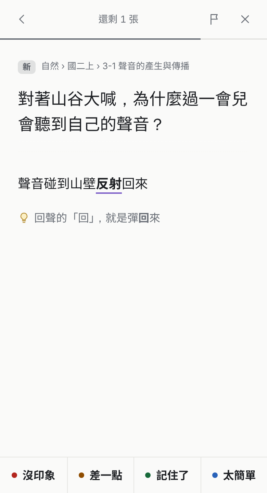

## 寫錯時會怎樣

只有寫錯的那個學習目標先不出題，同一篇的其他卡照常複習。編輯畫面會標出來：紅色波浪線是這一題不會出，橘色是照常出、但有地方看不懂；滑鼠移到波浪線上會寫原因。右上角的存檔按鈕會變成橘色的三角形。

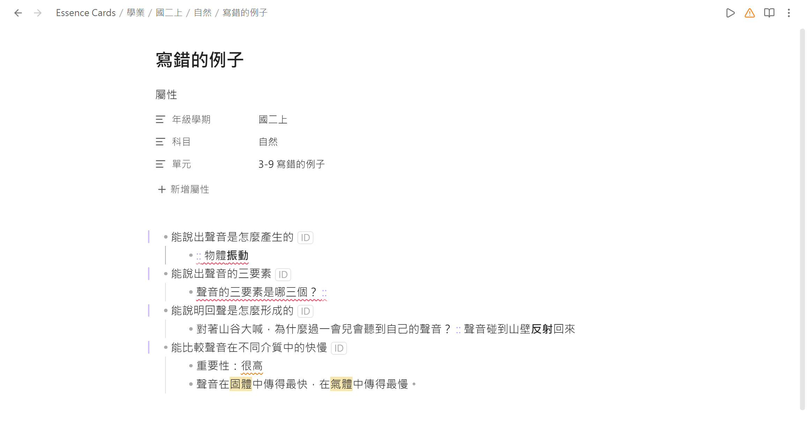

圖裡前兩個目標各有一題寫錯（紅色），最後一個目標的「重要性」填了程式看不懂的值（橘色）。按存檔時，通知會列出紅色的那幾題在第幾行、哪個目標、什麼原因，例如「第 7 行〈能說出聲音是怎麼產生的〉：這一題 :: 的左邊沒有題目」。改好就會加入複習，不用再做別的事。

| 算寫錯，這個目標先不出題 | 不算寫錯 |
|---|---|
| `::` 的左邊沒有題目 | 目標底下還沒有題目：當成一般筆記 |
| `題目 ::` 的底下沒有答案 | 縮排錯了一層：意思會變，但不會報錯；看左邊的細線有沒有畫在對的那一行 |

## 背後的規則

**一個目標可以寫好幾題嗎？**
可以。第一題是基本題，前幾次複習出它；答對之後輪流出其他題。同一個目標的每一題要考同一件事、難度相近。

**為什麼要分「學習目標」和「題目」兩層？**
排程照學習目標算。換一種問法、改錯字，進度都不會重來。細節見〈學習目標 ID 與題目指紋〉。

**我直接在最上層寫了題目會怎樣？**
存檔時程式會在上面補一行學習目標，名稱先用題目的字，你可以再改。

**還沒寫完，不想讓它出題？**
在最上面的屬性加一行 `狀態: 草稿`。草稿的卡組不會出題；寫完按筆記右上角的「啟用」，它是一個開關的圖示，滑鼠移上去會寫「啟用」。

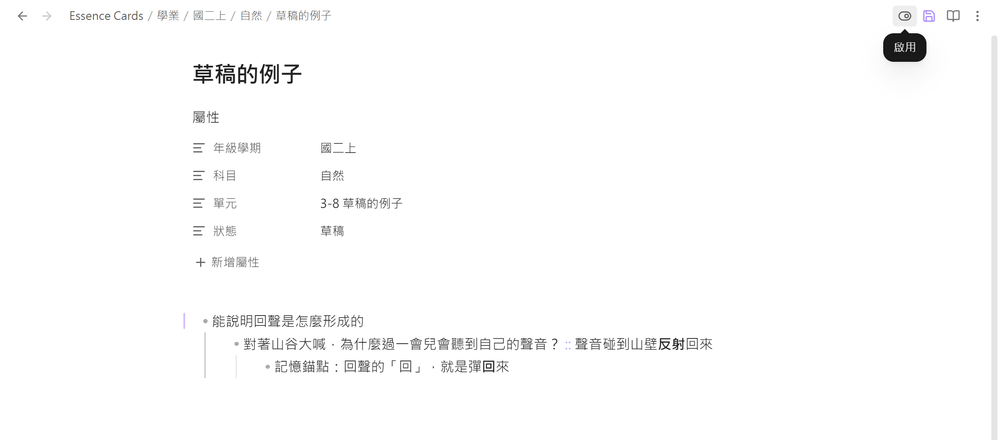

**怎麼先看卡片長什麼樣？**
在設定頁打開「顯示『預覽』按鈕」，卡組筆記右上角就多一顆眼睛圖示的「預覽」。預覽不記錄，也不影響排程。

**年級學期、科目、單元沒寫會怎樣？**
卡照樣能複習，只是在目錄裡排在最後的「其他」。

**可以用手機寫嗎？**
這一節的存檔與補編號只在電腦上做。

## 不能做的事

- 不要修改或刪除名稱那一行最後的編號（例如 `^s7k2m4`）。
- 想把一個目標改成考另一種能力時，另外寫一個新的學習目標，不要沿用舊的。

## 還沒寫進來的

這幾項功能還在做或還沒發布，做好之後補進這一節：

- 點選填空（相似字比較）怎麼由出題的人勾選
- 英文的打字與排序
- 古典詩的接句卡與全詩順序卡
- 已經複習過的目標怎麼拆開或合併
- 出處、重要性、備註這些資料欄位（另寫一節）

## 相關的節

- 學習目標 ID 與題目指紋
- 資料夾管理規範
- 用 AI 製卡
